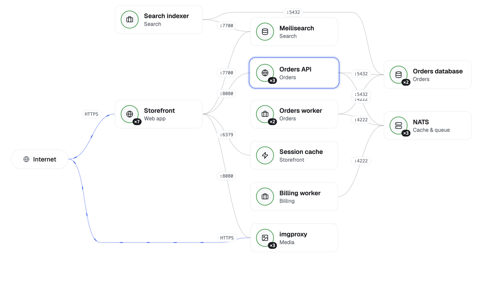

<p align="center">
  
</p>
<h1 align="center">Flui</h1>

<p align="center">
  <strong>Build your cloud platform on the providers you choose, and on servers you own.</strong>
</p>
<p align="center">
  <a href="LICENSE"></a>
  <a href="https://docs.flui.cloud"></a>
  <a href="https://www.npmjs.com/package/@flui-cloud/cli"></a>
  <a href="https://github.com/flui-cloud/flui-core/actions/workflows/docker-publish.yml"></a>
  <a href="https://github.com/flui-cloud/flui-core/actions/workflows/security.yml"></a>
</p>
<p align="center">
  <a href="https://flui.cloud">Website</a> ·
  <a href="https://flui.cloud/#install">Install</a> ·
  <a href="https://docs.flui.cloud">Docs</a> ·
  <a href="https://github.com/flui-cloud/flui-spec">flui.yaml spec</a>
</p>

<p align="center">
  <picture>
    <source media="(prefers-color-scheme: dark)" srcset="docs/assets/topology-app-dark.png">
    
  </picture>
</p>

Flui turns regional cloud providers and servers you own into one cloud platform. It provisions the servers, the private network, the firewall and the certificates, installs a Kubernetes runtime and runs your applications on it, with observability, autoscaling and managed databases built in. You work through a dashboard, a CLI or an AI agent, and you never need to know Kubernetes.

The whole platform runs on infrastructure you own. There is no Flui-hosted control plane in the middle, and every component Flui ships is open source.

If Flui is useful to you, a ⭐ helps other people find it.

## Why

Choosing a cloud provider shouldn't be a vow made at the altar. A provider can be the right choice today and the wrong one tomorrow, or excellent for one part of your system while another fits the rest better.

Flui does not try to be another giant. It builds a platform on top of the providers that already exist: it speaks each one's API, gives them one model to work with, and is honest about what each one can and cannot do. Where a provider lacks something, Flui completes it (a firewall on the host, a private network over WireGuard). Where another provider does it better, Flui composes them (servers from one, DNS from another).

The goal is a real choice, and the freedom to choose again: move applications and data to another provider without rebuilding everything on top of them.

## Install

You need Node.js 18 or later, and somewhere for Flui to run.

**On a server you already have** (Ubuntu 22.04 or 24.04, x86 or ARM, reachable over SSH)

```bash
npm install -g @flui-cloud/cli
flui vault init                    # a passphrase that seals your keys on this machine
flui env create --host <your-server-ip>
```

Without `--ssh-key` it asks for the password once and never stores it.

**On a cloud provider** (Hetzner, Scaleway or OVHcloud: Flui creates the server, private network and firewall)

```bash
npm install -g @flui-cloud/cli
flui vault init
flui config set hetzner            # asks for the key; it never leaves your machine
flui server-types list --provider hetzner --region nbg1 --fits
flui env create --provider hetzner --region nbg1 --node-size cx23
```

In about five minutes, depending on the machine and its network, you get a running platform with its own HTTPS address, no domain required. The [install page](https://flui.cloud/#install) builds these commands for the provider, city and server size you pick, and the [guide](https://docs.flui.cloud/tasks/get-flui-running/) covers every option.

## What you get

- **Infrastructure handled for you.** Servers, private networks, firewalls, DNS and TLS certificates, created through each provider's own API. One rule model for the firewall, whether the provider enforces it or Flui does on the host.
- **Several providers in one installation.** A control cluster manages workload clusters on other providers and on your own servers, connected over the Flui network (WireGuard). Keep backups on a different provider, or move an application from one to another.
- **Autoscaling with a spending cap.** Scaling groups add and remove servers between a minimum and a maximum, within a monthly budget, and wait out a server type that is temporarily sold out.
- **Observability from the first minute.** Metrics, logs and alerts are installed with the platform and shown where you need them: on each application, each cluster, its traffic.
- **Managed databases and a catalog.** PostgreSQL, MariaDB, Redis and more, with backups, point-in-time recovery for supported engines, connection pooling, an SQL console and migration between clusters. Plus ready-to-run applications and framework templates.
- **Dashboard, CLI and AI agents on the same API.** Agents connect over MCP with keys you can limit to one area, cluster or application, and changes they ask for wait for a person to approve them.

## Describe your app in flui.yaml

An application declares what it needs next to its code, without naming a provider or a Kubernetes resource. The format is an [open specification](https://github.com/flui-cloud/flui-spec) with its own schema and versioning, so other tools can read and write it too.

```yaml
apiVersion: flui.cloud/v1beta1
kind: Application
metadata:
  name: marketing-site
build:
  strategy: dockerfile
  dockerfile: ./Dockerfile
deploy:
  port: 3000
  exposure: public
  healthcheck:
    path: /api/health
  resources:
    profile: small
  scaling:
    min: 1
    max: 3
  domain:
    auto: true
    tls: true
```

```bash
flui app init nextjs          # or start from a framework template
flui catalog validate ./flui.yaml
flui deploy ./flui.yaml       # builds with GitHub Actions and rolls it out
```

## How it fits together

The **control cluster** runs Flui itself: the API, the dashboard, identity and the observability stack. **Workload clusters** run your applications, on the same provider or on others, and each starts with a single server. The runtime is [K3s](https://k3s.io); the rest is open source too: Traefik, cert-manager, VictoriaMetrics, Loki, Grafana, Zitadel, PostgreSQL and Redis.

Read more in the docs: [what Flui is](https://docs.flui.cloud/concepts/00-what-is-flui/), [multi-cluster topology](https://docs.flui.cloud/concepts/05-multi-cluster-topology/), [the network Flui builds](https://docs.flui.cloud/concepts/10-the-network-flui-builds/), [scaling groups](https://docs.flui.cloud/concepts/27-scaling-groups/), [the assistant and MCP](https://docs.flui.cloud/concepts/24-the-flui-assistant-and-mcp/).

## Status

Flui is in **alpha**. It already runs real workloads, the surface is large, and things will change before 1.0. Supported providers today are Hetzner, Scaleway and OVHcloud, plus any Linux server reachable over SSH.

## Repositories

- **flui-core** (this repository): the API and the CLI
- **[flui-dashboard](https://github.com/flui-cloud/flui-dashboard)**: the web dashboard
- **[flui-spec](https://github.com/flui-cloud/flui-spec)**: the `flui.yaml` specification
- **[bootstrap-scripts](https://github.com/flui-cloud/bootstrap-scripts)**: what gets installed on each server

## Contributing

Flui is meant to grow as a community project, and contributions of every size help: code, docs, a new provider integration, a framework template, a bug report. Something not working? [Open an issue](https://github.com/flui-cloud/flui-core/issues) and include the output of `flui version`. For larger changes, open an issue first so we can agree on the direction. The code is TypeScript (NestJS for the API, oclif for the CLI) and uses `pnpm`. The shared workflow is in [CONTRIBUTING.md](https://github.com/flui-cloud/.github/blob/main/CONTRIBUTING.md).

## License

[GNU Affero General Public License v3](LICENSE).

---

<p align="center">
  If Flui helps you, <a href="https://github.com/flui-cloud/flui-core">star it on GitHub</a>.
</p>
