<p align="center">
  
</p>
<h1 align="center">Flui</h1>

<p align="center">
  <strong>One cloud platform across European providers and your own servers.</strong>
</p>
<p align="center">
  <a href="LICENSE"></a>
  <a href="https://github.com/flui-cloud/flui-core/tags"></a>
  <a href="https://www.npmjs.com/package/@flui-cloud/cli"></a>
  <a href="https://github.com/flui-cloud/flui-core/actions/workflows/security.yml"></a>
</p>
<p align="center">
  <a href="https://demo-app.flui.cloud/try">Live demo</a> ·
  <a href="https://flui.cloud/#install">Install</a> ·
  <a href="https://docs.flui.cloud">Docs</a> ·
  <a href="https://github.com/flui-cloud/flui-spec">flui.yaml spec</a>
</p>

<p align="center">
  <picture>
    <source media="(prefers-color-scheme: dark)" srcset="docs/assets/flui-architecture-dark.svg">
    
  </picture>
</p>

**[Try the live demo](https://demo-app.flui.cloud/try)**: a read-only Flui instance, no account needed.

Flui is an open source platform built to manage infrastructure (servers, clusters, virtual networks, firewalls, DNS, certificates) and make it all work together, so that you can deploy applications and follow their whole lifecycle, on European cloud providers or on Ubuntu servers you own. The providers supported today are Hetzner, Scaleway and OVHcloud.

Flui makes sense when you have a fleet of servers to manage, and it is overkill for simple cases where one server is enough. Flui puts the user experience in an opinionated dashboard, designed around the concepts of application and cluster. It uses K3s as its engine, but you don't need to know Kubernetes to use it. So it is not an interface on top of K3s: it is a cloud platform, with a dashboard, a CLI and MCP as the touchpoints for the people and agents who use it.

## Why it was built

Flui was created to have a uniform user experience: to manage and deploy apps on clusters that live on different providers, to manage backups across providers, and to compose the best of each provider into a single platform.

## Install

You need Node.js 18 or later, and somewhere for Flui to run.

**On a server you already have** (Ubuntu 22.04 or 24.04, x86 or ARM, reachable over SSH)

```bash
npm install -g @flui-cloud/cli
flui vault init                    # a passphrase that seals your keys on this machine
flui env create --host <your-server-ip>
```

Without `--ssh-key` it asks for the password once and never stores it.

**On a cloud provider** (Hetzner, Scaleway or OVHcloud: Flui creates the server, private network and firewall)

```bash
npm install -g @flui-cloud/cli
flui vault init
flui config set hetzner            # asks for the key; it never leaves your machine
flui server-types list --provider hetzner --region nbg1 --fits
flui env create --provider hetzner --region nbg1 --node-size cx23
```

In about five minutes, depending on the machine and its network, you get a running platform with its own HTTPS address, no domain required. The [install page](https://flui.cloud/#install) builds these commands for the provider, city and server size you pick, and the [guide](https://docs.flui.cloud/tasks/get-flui-running/) covers every option.

## What it does today

- Creates a cluster on Hetzner, Scaleway or OVHcloud through their APIs, or installs on any Ubuntu 22.04 or 24.04 server over SSH.
- Joins a server you already have to a cluster with `flui node connect`, and adds or returns servers between a minimum, a maximum and a monthly spending cap.
- Connects clusters on different providers to one control plane over WireGuard.
- Builds and deploys applications described in a `flui.yaml` next to their code.
- Installs databases and services from a catalog: PostgreSQL, MariaDB, Redis, NATS, RabbitMQ, Kafka, Meilisearch and others.
- Backs up volumes and databases, with point-in-time recovery for PostgreSQL.
- Puts routes behind a gateway with single sign-on, rate limits and IP allowlists.
- Moves an application, a PostgreSQL database or both to another cluster, and cuts over when you are ready.
- Collects metrics, logs and alerts from the first minute.
- Exposes the same operations through the dashboard, the `flui` CLI and an MCP server for AI agents. Agents get keys limited to what they need, and a person approves what they change.

## What it does not do yet

- An application runs on one cluster. Flui does not spread one app across clusters, connect apps on different clusters to each other, or fail over between providers.
- Servers must run Ubuntu 22.04 or 24.04.
- DNS records need a zone on a provider Flui can drive. Without one, an app gets a `nip.io` name, or you point your domain yourself.
- Flui is in alpha.

## Describe your app in flui.yaml

An application declares what it needs next to its code, its database included, without naming a provider or a Kubernetes resource:

```yaml
apiVersion: flui.cloud/v1beta1
kind: Application
metadata:
  name: storefront
build:
  strategy: dockerfile
  dockerfile: ./Dockerfile
deploy:
  port: 3000
  exposure: public
  healthcheck:
    path: /api/health
  scaling:
    min: 1
    max: 3
  domain:
    auto: true
    tls: true
  env:
    SESSION_SECRET:
      valueFrom:
        generate: secret
        length: 48
  services:
    - name: db
      block: postgresql
      env:
        - name: DATABASE_URL
          fromService: url
```

On deploy, Flui installs PostgreSQL from its catalog, waits for it to be ready and hands the app its connection string as `DATABASE_URL`. That value and the session secret are generated on the cluster and delivered as secrets, so no password is ever written in the file. The app gets a public HTTPS address and runs between one and three copies.

From the repository that holds this `flui.yaml`:

```bash
flui integration connect github      # once: lets Flui build from your GitHub repositories
flui repo connect acme/storefront
flui deploy --validate-only          # checks the manifest against your cluster
flui deploy                          # builds with GitHub Actions and rolls it out
```

Starting from scratch? `flui app init nextjs` copies a `flui.yaml` and a Dockerfile from a framework template into your project.

The format is an [open specification](https://github.com/flui-cloud/flui-spec) with its own schema and versioning, so other tools can read and write it too.

## How it fits together

A **control cluster** runs Flui itself: the API (NestJS, state in PostgreSQL, job queues on Redis), the dashboard, sign-in (Zitadel) and the observability stack (VictoriaMetrics, Loki, Grafana). **Workload clusters** run your applications on [K3s](https://k3s.io), with Traefik and cert-manager in front, and reach the control cluster over the WireGuard network Flui builds. Each starts with a single server.

Read more in the docs: [what Flui is](https://docs.flui.cloud/concepts/00-what-is-flui/), [multi-cluster topology](https://docs.flui.cloud/concepts/05-multi-cluster-topology/), [the network Flui builds](https://docs.flui.cloud/concepts/10-the-network-flui-builds/), [scaling groups](https://docs.flui.cloud/concepts/27-scaling-groups/), [the assistant and MCP](https://docs.flui.cloud/concepts/24-the-flui-assistant-and-mcp/).

## Repositories

- **flui-core** (this repository): the API and the CLI
- **[flui-dashboard](https://github.com/flui-cloud/flui-dashboard)**: the web dashboard
- **[flui-spec](https://github.com/flui-cloud/flui-spec)**: the `flui.yaml` specification
- **[bootstrap-scripts](https://github.com/flui-cloud/bootstrap-scripts)**: what gets installed on each server

## Contributing

Flui is meant to grow as a community project, and contributions of every size help: code, docs, a new provider integration, a framework template, a bug report. Something not working? [Open an issue](https://github.com/flui-cloud/flui-core/issues) and include the output of `flui version`. For larger changes, open an issue first so we can agree on the direction. The code is TypeScript (NestJS for the API, oclif for the CLI) and uses `pnpm`. Contributions are licensed under the repository's license, with no CLA or DCO sign-off; the shared workflow is in [CONTRIBUTING.md](https://github.com/flui-cloud/.github/blob/main/CONTRIBUTING.md).

## License

[GNU Affero General Public License v3](LICENSE).
